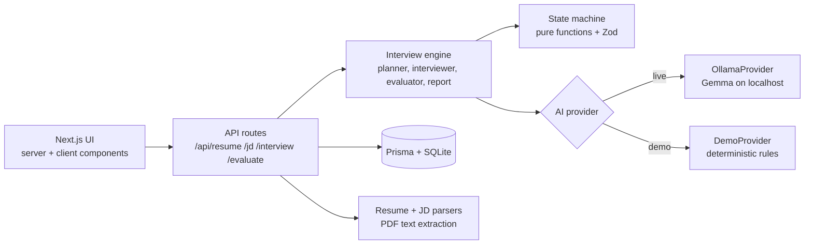

# Interview Dost

> Most interview practice gives you questions.
> **Interview Dost gives you an interviewer.**

Your resume shapes the questions. Your answers shape the follow-ups. Your weak areas shape what you practice next.

## Problem

Interview prep usually means lists of questions, generic mock interviews and static exercises. None of them *listen*: the 5th question is the same no matter how you answered the 4th, and nothing connects your weak answers to what you should practise.

## Solution

Interview Dost simulates a real interview, one question at a time:

```
Resume + Job Description -> Interview plan -> Question -> Your answer
   -> Evaluation -> Targeted follow-up / difficulty change -> ... -> Report -> 3 personalised drills
```

It behaves like an **interviewer**, not a tutor: it never coaches mid-interview, it asks specific follow-ups ("What trade-off did you weigh, and what breaks first at 100,000 concurrent users?") instead of "tell me more", and it only references experience that actually exists in your resume.

## Why Open-Weight AI

- **No paid API.** The core runs on an open-weight Gemma model served locally by [Ollama](https://ollama.com).
- **Your data can stay on your machine.** Resumes and interview answers are sensitive. With a local model, the AI calls go to `localhost`.
- **Replaceable.** The model is one env var (`OLLAMA_MODEL`). The AI layer is a provider interface, so another open-weight runtime can be added without touching the UI.
- **Judge-friendly.** It works offline, with no keys, and there is a deterministic Demo Mode if Ollama is unavailable.

## Features

- Home, Practice Studio, Library and Progress pages driven by **real completed sessions** (empty states instead of fake stats)
- 6-step custom session setup: PDF/paste resume, JD, type, experience, length, style (extracted data is editable before use)
- Adaptive interview screen with timer, progress and live practice signals
- "What your interviewer noticed" card after every answer: missing detail, follow-up, difficulty change
- Final report: practice signals, adaptive timeline, improvements, strong moments, **next 3 drills** that launch real sessions
- Demo Mode, friendly error handling, responsive layout, keyboard and screen-reader support

## Adaptive Interview Engine

After every answer the engine runs one turn (`lib/ai/interviewer.js`):

1. **Evaluate** the answer (technical accuracy, clarity, specificity, completeness, weak areas, one line of user-facing feedback).
2. **Decide** the next action: `follow_up`, `clarification`, `deeper_technical`, `behavioral_probe`, `next_topic`, `increase_difficulty`, `decrease_difficulty`.
3. **Apply** it in a pure state machine (`lib/interview/state.js`): difficulty shifts and is clamped, topics covered and weak areas accumulate, and at most one follow-up is allowed in a row so the interview keeps moving.
4. **Generate** the next question from the plan, the candidate profile and the last answer.
5. After the last question, generate the **report and drills** from weak areas actually observed in the transcript.

Guarantees:

- Every model response is validated with **Zod** (one automatic retry on invalid JSON). Uncontrolled model text never becomes application state.
- Prompts ask for concise JSON decisions only. No chain-of-thought is requested, stored or shown.
- The browser only receives `toPublicState` (no plan, no prompts, no raw model output).
- A turn is atomic: if the model fails midway, nothing is saved and the user can retry.

## Architecture



```
app/            routes, pages, API handlers
components/     ui, layout, dashboard, practice (wizard), interview, results
lib/ai/         provider, ollama, demo, planner, interviewer, evaluator, report,
                resume-parser, jd-parser, prompts, schemas (Zod), errors
lib/interview/  state machine (pure) and public-state mappers
lib/db/         Prisma client (lazy), session persistence, stats
lib/practice/   practice cards and library catalog
prisma/         schema.prisma
tests/          schemas, parsers, interview flow
```

Parsers are heuristic and deterministic (fast, offline, testable), and the user confirms or edits the result. The LLM is used where reasoning is needed: planning, evaluating, follow-ups and the report.

## Tech Stack

Next.js 14 (App Router), JavaScript only (no TypeScript), React, Tailwind CSS, Ollama + Gemma, Prisma + SQLite, Zod, pdf-parse, Vitest.

## Local Setup

Requirements: Node.js 18.18+ and npm.

```bash
npm install
cp .env.example .env
npx prisma migrate dev --name init
npm run dev
```

Open http://localhost:3000 (landing page). The app itself lives at `/home`. **"Try the 3-minute demo"** on the landing page opens the wizard with Demo Mode on and the sample resume and job pre-filled.

## Ollama Setup

1. Install Ollama from https://ollama.com/download.
2. Make sure it is running (`ollama serve`, or the desktop app). Default address: `http://localhost:11434`.

## Model Setup

```bash
ollama pull gemma2:9b
```

Then set it in `.env`:

```
OLLAMA_BASE_URL="http://localhost:11434"
OLLAMA_MODEL="gemma2:9b"
```

Use any Gemma tag you have pulled (`ollama list`). Smaller models are faster but produce weaker follow-ups and may need the automatic JSON retry more often. If the model is missing, the app tells you the exact `ollama pull` command.

## Demo Mode

Demo Mode is a **deterministic rule-based provider**, not an AI model. It exists so the full flow can be shown without Ollama, and the UI always labels it ("Demo Mode, scripted responses, not live AI").

- Per session: tick **Demo Mode** in the setup wizard (also offered when Ollama is unavailable).
- Globally: `DEMO_MODE="true"` in `.env`.
- Use **"Use sample resume"** and **"Use sample job"** in the wizard (clearly labelled demo data).

### 3-minute demo script

0. Fastest start: on the landing page click **Try the 3-minute demo** (Demo Mode and sample data are pre-filled; just click Extract details and Analyze).
1. Or manually: Practice -> Custom Session. Click **Use sample resume** -> Extract details -> Next.
2. Click **Use sample job** -> Analyze -> Next.
3. Choose **Technical**, **Intermediate**, **5 minutes**, **Realistic**, then **Start Interview**.
4. Give a deliberately weak answer: `I used WebSockets because they are fast.`
5. The "What your interviewer noticed" card shows the missing detail, and a **Follow-up** question appears.
6. Give a strong answer, for example: `I designed the chat service and chose WebSockets instead of polling because polling added 800ms latency at 5000 users. The trade-off was sticky sessions, so I added Redis pub/sub to scale horizontally, which cut p95 latency to 120ms.`
7. Difficulty rises (`medium -> hard`) and the next question is harder.
8. Finish the interview. The report shows the adaptive timeline, weak areas and **your next 3 drills**. Click **Start drill**.

## Privacy

- With a local Ollama server, resume text and answers are sent only to that local server. Nothing in this app calls a cloud AI API.
- Sessions are stored in a local SQLite file (`prisma/dev.db`). The "reuse last resume" shortcut uses your browser's localStorage.
- This holds only if `OLLAMA_BASE_URL` points to your own machine. If you point it at a remote server, your data goes there.
- This is a local practice tool, not a security product. There is no authentication and no encryption at rest.

## Database

Prisma + SQLite, deliberately simple: `User` (single local user), `InterviewSession`, `InterviewQuestion`, `AnswerEvaluation`, `PracticeDrill`. The full interview state is stored as validated JSON on the session so an interrupted interview can be resumed by reopening `/interview/<id>`.

```bash
npx prisma migrate dev --name init   # create the DB
npx prisma studio                    # inspect it
```

## Testing

```bash
npm test
```

Covers state transitions, Zod validation of model output, evaluation parsing, resume and JD extraction, and a full end-to-end interview with the deterministic provider (weak answer -> follow-up -> harder question -> report and drills).

## Known Limitations

- Live-model quality depends on the Gemma size you run. Test your model before a demo.
- Resume and JD parsing is heuristic; the editable confirmation step is the safety net. Scanned (image) PDFs are not supported.
- Practice signals are rough indicators from one session, not scientific measurements.
- No voice input yet, no authentication, single local user.

## Future Improvements

- Voice answers (speech-to-text, local Whisper) and pacing feedback
- Optional LLM-assisted resume parsing for unusual layouts
- More providers (llama.cpp, vLLM) behind the same interface
- Spaced repetition for recurring weak areas
- Export reports as PDF
- Evaluation benchmarks to compare open-weight models on follow-up quality
